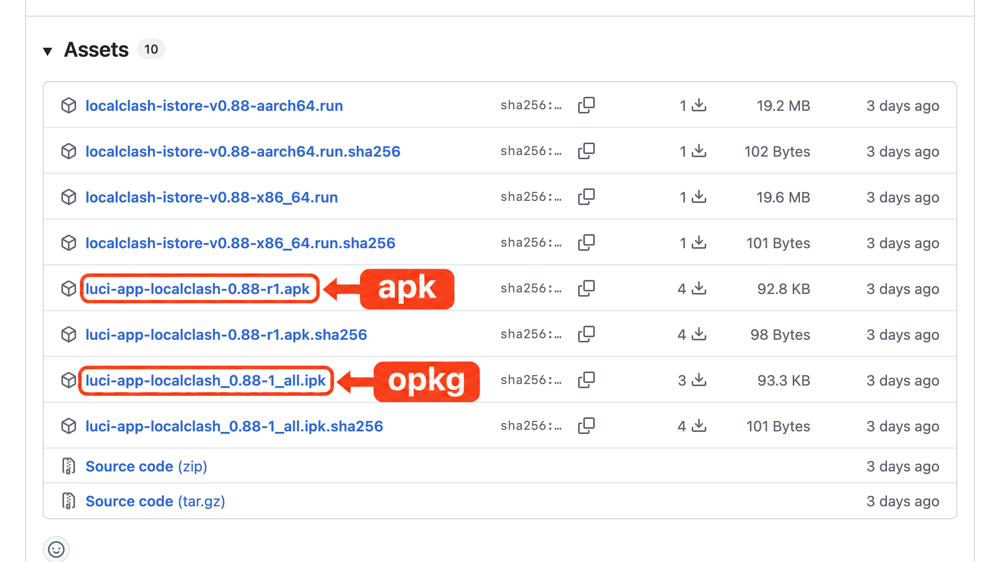
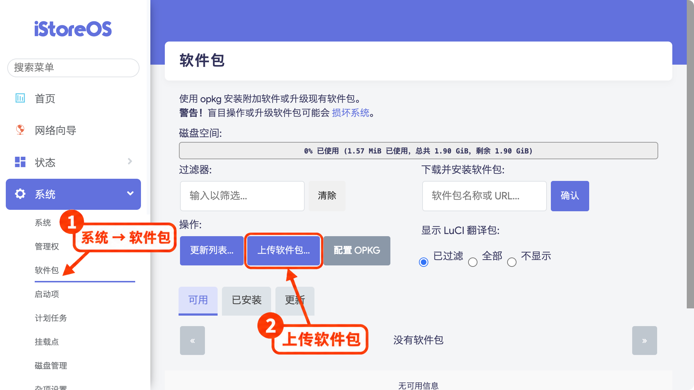
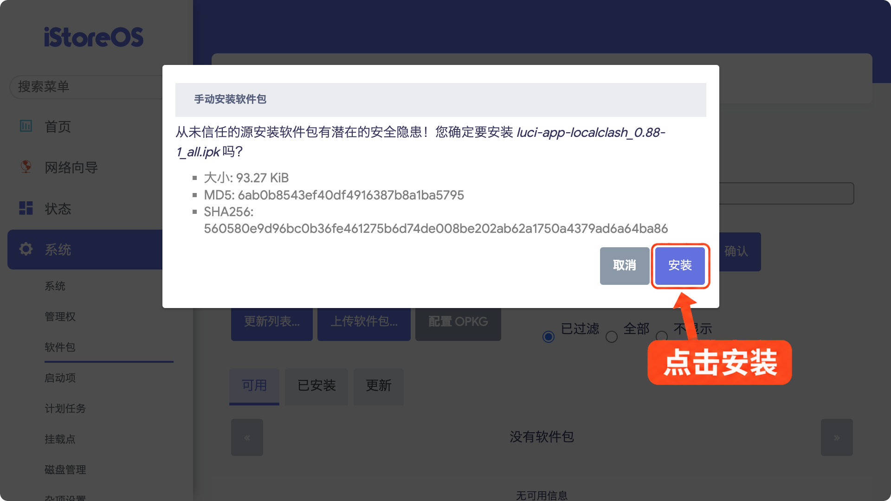
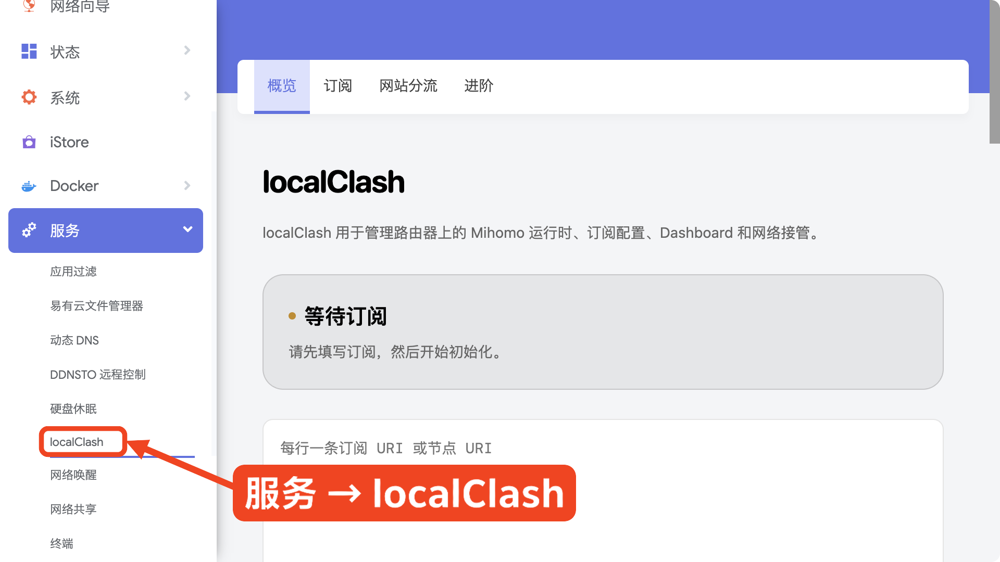
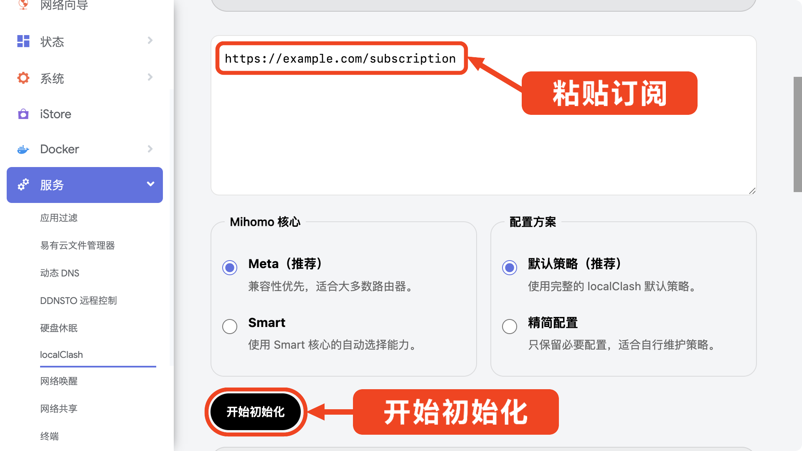
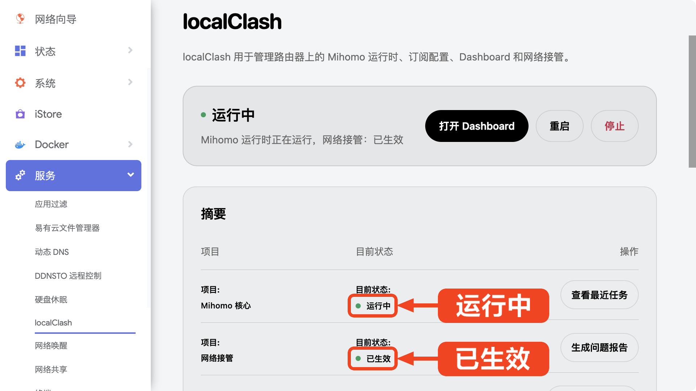

# localclash-luci

跟着图在 OpenWrt 后台安装并启动 localClash。先用电脑连上这台路由器，在浏览器打开路由器的管理地址并登录。确认路由器能联网，再准备一条服务商提供的订阅地址或节点链接。图例使用 iStoreOS 上的 LuCI v0.88。

> localClash 是独立维护的开源项目。如果它帮你省了配置 Mihomo 或接管路由器网络的时间，可以请作者喝杯咖啡，支持项目继续维护。
>
> **[查看自愿赞助方式](https://github.com/qoli/localClash#支持-localclash)**

## 第 1 步：下载安装包



先看路由器后台「系统 → 软件包」显示的管理器。然后打开[最新发布页](https://github.com/qoli/localclash-luci/releases/latest)，展开 **Assets**，选一个对应的文件。

- **opkg**（例如 OpenWrt 24.10 或 iStoreOS）选 `.ipk`，继续[第 2 步](#第-2-步上传-ipk)。
- **apk**（例如 OpenWrt 25.12）选 `.apk`，先完成 [APK 安装](#apk-安装)。

以 `.sha256` 结尾的文件用于核对校验值。

## 第 2 步：上传 .ipk



登录路由器后台，点「系统 → 软件包 → 上传软件包…」，选择刚下载的 `.ipk`，再点「上传」。

## 第 3 步：点击「安装」



确认弹窗里是刚从发布页下载的文件，点「安装」。安装成功后，点「关闭」并刷新后台，再继续[第 4 步](#第-4-步打开-localclash)。

## 第 4 步：打开 localClash



点左侧「服务 → localClash」，看到「等待订阅」就可以继续。如果还没看到 localClash 菜单，退出后台再登录一次。

## 第 5 步：填订阅并初始化



粘贴你自己的订阅地址或节点链接，每行一条。图里是示例。

如果 OpenClash 或 PassWall 正在接管这台路由器的网络，先到对应插件停止接管。保留「Meta（推荐）」和「默认策略（推荐）」，再点「开始初始化」。

## 第 6 步：确认运行并上网



看到「任务完成」后回到「概览」。确认「Mihomo 核心」显示「运行中」、「网络接管」显示「已生效」，再用连着这台路由器的手机或电脑打开一个常用网站。

### 初始化失败或网络接管未生效

- 初始化报错时，在「概览 → 摘要」的「Mihomo 核心」一行点「查看最近任务」，查看失败的步骤和错误。
- 网络接管未生效时，在「网络接管」一行点「生成问题报告」，预览后可以下载报告。

## APK 安装

OpenWrt 的软件包页面可能会拒绝单独下载的 `.apk`，报 `UNTRUSTED signature`。可以用 SSH 登录路由器来安装这一个文件。[OpenWrt LuCI 的相关问题](https://github.com/openwrt/luci/issues/8482)

1. 从同一发布页下载 `.apk` 和对应的 `.apk.sha256`。把安装包重命名为 `localclash.apk`，在下载目录打开终端。用 macOS 的 `shasum -a 256 localclash.apk`、Linux 的 `sha256sum localclash.apk` 或 PowerShell 的 `Get-FileHash localclash.apk -Algorithm SHA256` 计算校验值，与 `.apk.sha256` 里的值比较。
2. 把以下命令里的 `192.168.1.1` 换成你登录路由器后台时用的 IP。第一行把安装包传到路由器，第二行登录路由器。

   ```sh
   scp -O ./localclash.apk root@192.168.1.1:/tmp/localclash.apk
   ssh root@192.168.1.1
   ```

3. 确认校验值一致后，在路由器终端安装。

   ```sh
   apk add --allow-untrusted /tmp/localclash.apk
   ```

   安装完成后刷新后台，继续[第 4 步](#第-4-步打开-localclash)。

## 支持 localClash

localClash 是独立维护的开源项目。如果它帮你省了配置 Mihomo 或接管路由器网络的时间，可以请作者喝杯咖啡，支持项目继续维护。

**[查看自愿赞助方式](https://github.com/qoli/localClash#支持-localclash)**

[Core](https://github.com/qoli/localClash) · [MIT License](LICENSE)
