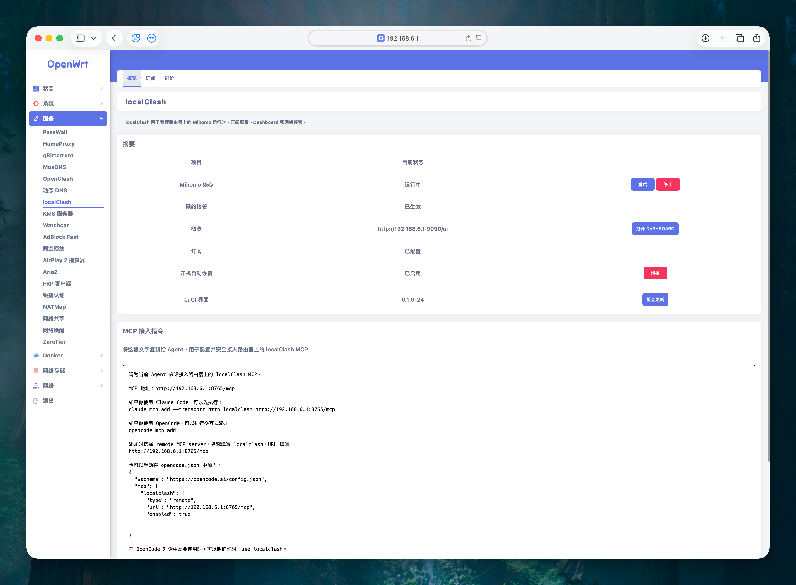
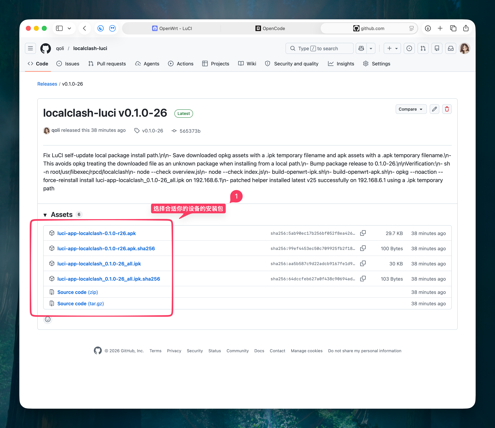
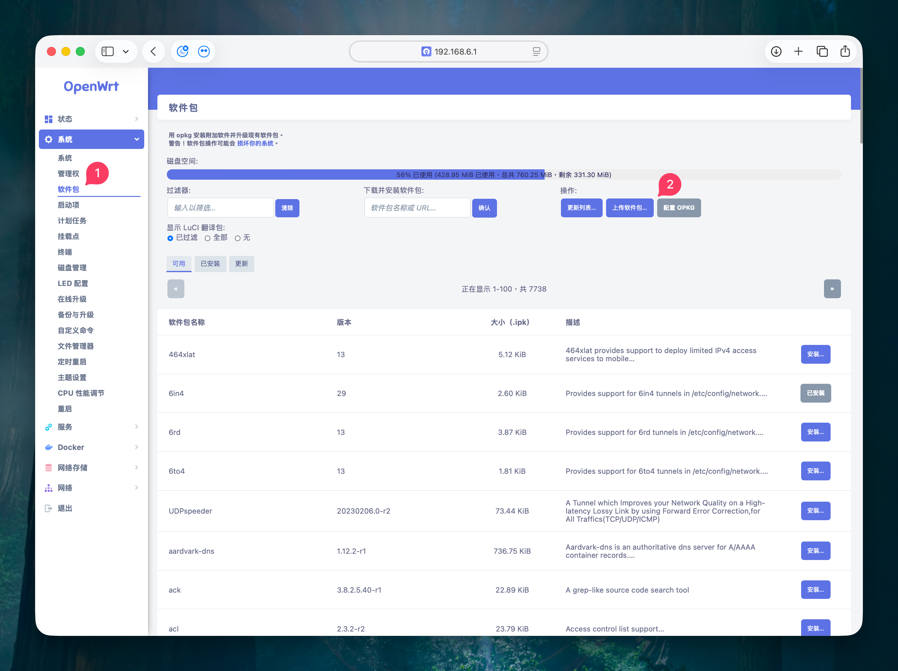
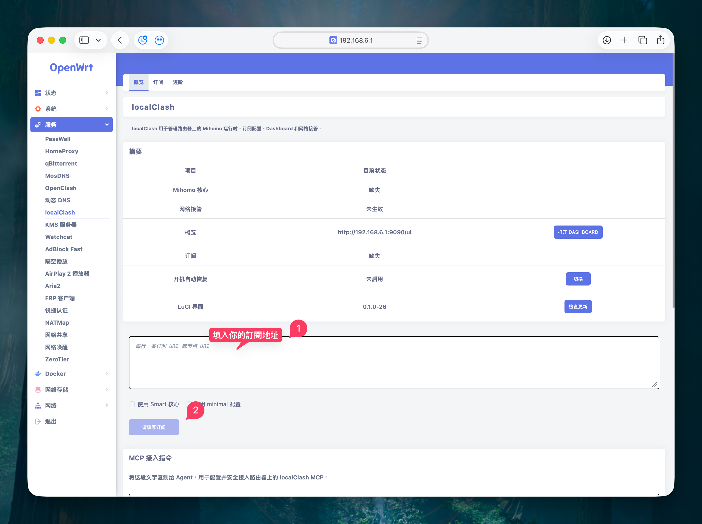

# localclash-luci

[](https://github.com/qoli/localclash-luci/releases/latest)
[](LICENSE)
[](https://openwrt.org/)
[](https://github.com/qoli/localClash)

`localclash-luci` 是 localClash 的 OpenWrt 后台页面。你不用写命令，也不用手动配置 Mihomo，只要在 OpenWrt 后台上传安装包、填入订阅地址，然后等待初始化完成。



> [!TIP]
> ☕ localClash 是独立维护的开源项目。如果它帮你省了配置 Mihomo 和接管路由器网络的时间，欢迎支持项目继续维护。
>
> [](https://github.com/qoli/localClash#支持-localclash)
>
> [支持 localClash](https://github.com/qoli/localClash#支持-localclash)

责任划分：Core 管理订阅、Mihomo 配置与验证、程序生命周期及版本化 runtime facts；
本项目负责 LuCI、包和 ACL，以及 fw4/nftables、策略路由、DNS 接管、
boot/hotplug 恢复和跨 runtime/takeover 的事务。普通 IPK/APK 只安装界面和集成文件；
核心及资源由用户显式初始化下载。

最简单的流程是：

```text
下载 LuCI 安装包 -> 上传到 OpenWrt -> 进入 服务 -> localClash
-> 填写订阅地址 -> 开始初始化 -> 看到“运行中”
```

## 适合谁

- 你有一台已经刷好 OpenWrt 的路由器。
- 你能打开 OpenWrt 后台，例如 `http://192.168.6.1` 或你自己的路由器地址。
- 你手上有一个订阅地址，或者有单独的节点 URI。
- 你想让 localClash 帮你管理 Mihomo、订阅、Dashboard 和路由器网络接管。

如果你还不知道“订阅地址”是什么，先向你的服务提供方确认。localClash 不提供订阅，也不提供节点。

## 第 1 步：下载安装包

打开最新发布页：

[https://github.com/qoli/localclash-luci/releases/latest](https://github.com/qoli/localclash-luci/releases/latest)

在页面下方找到 `Assets`，这里会列出可以下载的文件。



图里的红色 `1` 标出来的是下载区域。你只需要在这里选一个适合自己路由器的安装包。

只需要下载一个安装包：

| 你的路由器系统 | 下载哪个文件 |
| --- | --- |
| OpenWrt 24.10 或更旧，后台软件包页面使用 `opkg` | 下载文件名以 `_all.ipk` 结尾的文件 |
| OpenWrt 25.12 或更新，后台软件包页面使用 `apk` | 下载文件名以 `.apk` 结尾的文件 |

大多数用户应该下载 `.ipk`。如果你不确定，就先看 OpenWrt 后台的软件包页面：页面上写着 `opkg` 就选 `.ipk`，写着 `apk` 就选 `.apk`。

不要下载这些文件：

- `.sha256`：这是校验文件，不是安装包。
- `Source code (zip)` / `Source code (tar.gz)`：这是源码，不是给路由器后台上传的安装包。

## 第 2 步：上传到 OpenWrt

打开 OpenWrt 后台，进入：

```text
系统 -> 软件包
```



图里的红色 `1` 是左侧的 `软件包` 菜单。红色 `2` 附近是操作按钮区域，普通安装本地包时，点击旁边的 `上传软件包...` 即可，不需要修改 OPKG 配置。

按顺序操作：

1. 左侧菜单点 `系统`。
2. 点 `软件包`。
3. 点页面里的 `上传软件包...`。
4. 选择刚才下载的 `.ipk` 或 `.apk` 文件。
5. 上传后确认安装。
6. 安装完成后，刷新浏览器页面。

如果左侧菜单没有出现 `localClash`，先退出 OpenWrt 后台再重新登录。还是没有的话，重启一次路由器。

## 第 3 步：进入 localClash

安装完成后，在左侧菜单进入：

```text
服务 -> localClash
```

第一次进入时，通常会看到 Mihomo 核心缺失、订阅缺失、网络接管未生效。这是正常的，因为你还没有初始化。

## 第 4 步：填写订阅并初始化

在 `服务 -> localClash` 页面中，找到订阅输入框。



图里的红色 `1` 是订阅输入框。红色 `2` 是初始化按钮所在的位置。

按顺序操作：

1. 把你的订阅地址粘贴进去。
2. 如果有多个订阅或节点，每行放一个地址。
3. 选择核心与策略模板；一般用户保持默认 Meta 核心和完整默认策略即可。
4. 点击 `开始初始化`。
5. 等待任务完成，不要中途刷新页面或断电。

初始化会自动做这些事：

- 下载或更新 localClash 核心。
- 下载 Mihomo 核心和 Dashboard。
- 保存并刷新订阅。
- 生成 Mihomo 配置。
- 启动运行时。
- 接管路由器网络。

这一步会影响整台路由器的上网。如果这台路由器正在依赖 OpenClash、PassWall 或其他插件维持网络，先确认你知道怎么切回原来的插件，再点 `开始初始化`。

## 第 5 步：确认已经成功

初始化完成后，回到 `概览` 页。看到下面这些状态，说明已经跑起来了：

- `Mihomo 核心` 显示 `运行中`。
- `网络接管` 显示 `已生效`。
- `订阅` 显示 `已配置`。
- 页面上有 `打开 Dashboard` 按钮。


点击 `打开 Dashboard` 会读取当前 Mihomo 运行配置，使用路由器的 LAN 地址、Controller 端口和 secret 自动进入 Dashboard，无需用户再次填写连接参数。Dashboard 可用于查看节点、连接和规则命中情况。

## 让 Agent 管理 localClash

概览页底部提供 `Agent Skill 与 MCP 接入`。点击 `复制 Skill + MCP 指令`，把完整内容发送给 Codex、Claude Code 或 OpenCode。

如果使用 Codex，建议同时安装 localClash 官方配套的 `localclash-mcp-route-operator` Skill。Skill 会引导 Agent：

- 先从配置意图、Mihomo 已加载状态、当前连接和限定时间日志收集证据。
- 为单一服务、应用或游戏建立专用策略出口，不随意覆盖“自动选择”等共享或默认策略组。
- Draft 一旦触及 shared/default group 就停止套用；只有你明确确认具体共享变更后，才允许继续。
- 把配置写入、运行时加载、服务重启和路由器网络接管视为不同授权。

Skill 与 MCP 缺一不可：Skill 约束 Agent 如何规划和操作，MCP 才是连接真实路由器、读取状态与执行已授权变更的通道。LuCI 提供的复制文本会同时引导这两步，并自动带入当前路由器的 MCP 地址。

## 以后怎么更新

在 `服务 -> localClash -> 概览` 点击 `一键更新`，更新 LuCI、localClash、
Mihomo 和 Dashboard。下载、订阅刷新、策略同步、配置生成及验证先准备好，
最后只进行一次 Mihomo 运行时切换：核心 binary 发生变化时重启程序，
只有材料变化时热加载。随后读回运行时及网络接管状态；切换期间可能短暂断网。
结果中的软件／材料检查点字段描述这次批量提交，不代表先重启、再热加载两次。

LuCI 包更新后，任务保存快照并以同一 PID 交接给磁盘上的新版 helper；
新版校验任务锁、状态版本和阶段后继续。localClash 核心替换后，由该任务
重启并检查 MCP 服务。普通 package `postinst` 不下载核心，也不管理 MCP 生命周期。
缺少这套交接能力的旧版，首次升级先在 `高级组件维护` 更新 LuCI，
任务完成并刷新页面后再一键更新。

`同步最新默认策略（推荐）` 默认勾选，会重置本地策略补丁，包含用户自定义补丁；
独立的 `网站分流` 自定义列表会保留并校验数量及 SHA。取消勾选则保留当前策略；
该选择会保存供后续更新使用。

订阅源临时不可用时，Core 可以使用经过校验的该源缓存，并保留 `cached` 状态和警告；
没有合法下载或缓存的来源会排除。仍有有效来源时可继续生成、验证及提交；
所有来源均无效则失败并保留先前合并材料。因此“完成但有警告”不表示全部来源已下载成功。
下载、安装、生成、验证或运行时提交失败都会明确报告；根据任务结果核对已完成阶段、
回滚结果与接管状态，再决定后续操作。

如果要单独维护某个组件，可以使用 `高级组件维护`：

- 点 `安装 / 更新核心`：安装或刷新 localClash 核心和基础文件。
- 点 `更新 localClash`：更新 localClash 运行时程序。
- 点 `更新 Mihomo`：更新 Mihomo 核心。
- 点 `更新 Dashboard`：更新 Dashboard 面板文件。

如果只是更新这些组件，通常不需要重新下载 `.ipk` 或 `.apk`。只有页面里的 `检查更新` 不可用，或者你需要手动安装指定版本时，才回到 GitHub Release 重新下载 LuCI 安装包。

重新初始化主要用于重新应用默认配置、刷新订阅并重新启动运行时。只是普通更新时，不需要反复点击 `开始初始化`。

## 常见问题

### 安装后看不到菜单

先刷新浏览器页面。如果还看不到，退出 OpenWrt 后台并重新登录。仍然没有的话，重启路由器。

### 点初始化前要不要先关掉 OpenClash 或 PassWall

建议先关闭 OpenClash、PassWall 或其他会接管路由器网络的代理插件，再开始 localClash 初始化。这样可以避免多个插件同时修改防火墙、DNS 或透明代理规则，确保 localClash 能正常接管网络。

### 订阅地址填在哪里

填在 `服务 -> localClash` 页面里的大输入框中。每行一个订阅 URI 或节点 URI。

### `.sha256` 要不要下载

不要。普通用户只需要下载 `.ipk` 或 `.apk` 安装包。

### 初始化失败

先看任务窗口日志，检查路由器时间、DNS、GitHub 可达性，以及当前网络是否依赖旧代理
才能下载。普通包安装不包含 runtime，首次进入显示核心缺失是正常状态；
通过初始化显式安装所需组件。保留失败阶段和错误信息，不要连续重复初始化掩盖首个失败。

### 订阅、网站和进阶设置

页面分为 `概览`、`订阅`、`网站分流` 和 `进阶`。`保存并应用订阅` 会刷新材料、
生成配置并重启运行时；定时刷新对已运行核心热加载，不会自动启动停止的核心。
刷新警告、任务完成、程序运行和网络接管有效是不同状态。

`网站分流` 只接受域名或含 `*`／`?` 的主机模式，选择代理或直连；
不含通配符时匹配域名及子域名。两份列表中最新匹配项优先，删除后可能显露旧规则；
同名黄色警告不阻止保存。代理沿用现有出口，指定国家或 Smart 策略请通过 Agent/MCP。
列表跨默认策略同步保留，但恢复未配置状态的一般重置会删除它。

Agent 管理真实路由器时，使用概览页复制的 Skill + MCP 接入信息；
本地源码和节点名称不能代替路由器已加载状态或真实流量证据。

## 支持 localClash

如果 localClash 帮你省了配置 Mihomo 和接管路由器网络的时间，可以请作者喝杯咖啡，支持项目继续维护：

[](https://github.com/qoli/localClash#支持-localclash)

[支持 localClash](https://github.com/qoli/localClash#支持-localclash)

## 维护与验收

- [Core 使用与运行时说明](https://github.com/qoli/localClash#readme)。
- [功能测试表](https://github.com/qoli/localClash/blob/main/docs/istoreos-test-features.md)
  保存最后实测版本和证据；按改动选测，核对后沿用历史结果，不要求发布时重跑全表。
- [测试 Skill](https://github.com/qoli/localClash/blob/main/.codex/skills/localclash-istoreos-test/SKILL.md)
  集中 QEMU 方法、真实订阅现场、旧版升级及外部 oracle。
- [发布与公告 Skill](https://github.com/qoli/localClash/blob/main/.codex/skills/localclash-release-broadcast/SKILL.md)
  集中 LuCI tag/CI、离线 Core pin、资产核对和公告流程。

## 社区

感谢 [LINUX DO](https://linux.do/) 为开源项目提供分享和交流的社区。

## 许可证

MIT License。见 [LICENSE](LICENSE)。
